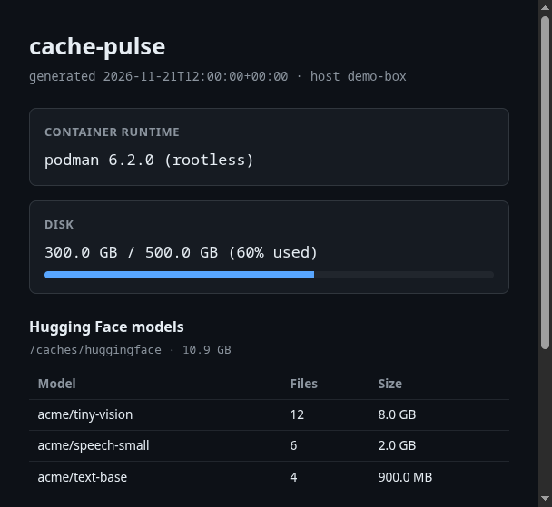

# cache-pulse

**Know what's eating your disk before the disk does.**

Your machine is full of Hugging Face weights and PyTorch hubs you downloaded months ago
and have forgotten about. `cache-pulse` inspects your local AI model caches and
container runtime in one shot and renders a self-contained HTML dashboard —
in your browser, or inside a container — with a single command.
No daemon, no dependencies, no telemetry.



## Features

- **Hugging Face inventory** — every cached repo in `HF_HOME` with file count and size
- **PyTorch inventory** — every `TORCH_HOME` directory with size
- **Container runtime probe** — rootless Podman first, Docker fallback; version + rootless status
- **Disk pressure view** — used/total on the cache filesystem with a usage bar
- **Self-contained dashboard** — one HTML file (`out/latest.html`), zero external assets
- **Local web server** — `serve` renders (if needed) and serves the report over HTTP
- **Optional webhook alerts** — Bearer-token JSON POST when disk usage crosses a threshold
- **Containerized** — stdlib-only OCI image: Podman today, Docker-compatible compose
- **Read-only by design** — never downloads models, never mutates caches, zero pip dependencies

## Quickstart (host)

```bash
uvx ruff check .                        # lint
uvx --with pytest pytest -q             # tests
PYTHONPATH=src python3 -m cache_pulse inspect --json
PYTHONPATH=src python3 -m cache_pulse report      # writes out/latest.html
PYTHONPATH=src python3 -m cache_pulse serve --port 8080   # http://127.0.0.1:8080/latest.html
```

Cache locations come from `HF_HOME` / `TORCH_HOME` (defaults
`~/.cache/huggingface`, `~/.cache/torch`).

## Container (Podman today, Docker-compatible)

```bash
cp .env.example .env        # adjust if your caches live elsewhere
mkdir -p out
podman compose up --build   # dashboard on http://localhost:8080/latest.html
```

Docker users: `docker compose up --build` — same `compose.yml`, plain OCI image,
stdlib only (no pip step). The Podman rootless socket mount lives in
`compose.override.yml` (gitignored); enable it with
`cp compose.override.yml.example compose.override.yml`, or skip overrides with
`podman compose -f compose.yml up --build`.

## Alerts (optional)

Create `~/.config/cache-pulse/config.json` (or pass `report --config <path>`):

```json
{"webhook_url": "https://example.com/hook", "api_token": "***", "disk_threshold": 0.9}
```

`report` POSTs a JSON alert (Bearer `api_token`) to `webhook_url` when disk usage
of the cache filesystem crosses `disk_threshold` (0..1, default 0.9).

## Layout

- `src/cache_pulse/inspector.py` — cache dirs, repo sizes, podman/docker probe, config, webhook
- `src/cache_pulse/renderer.py` — HTML rendering to `out/latest.html`
- `src/cache_pulse/cli.py` — argparse entrypoint (`inspect` / `report` / `serve`)
- `templates/dashboard.html` — self-contained dashboard template
- `tests/` — pytest suite
